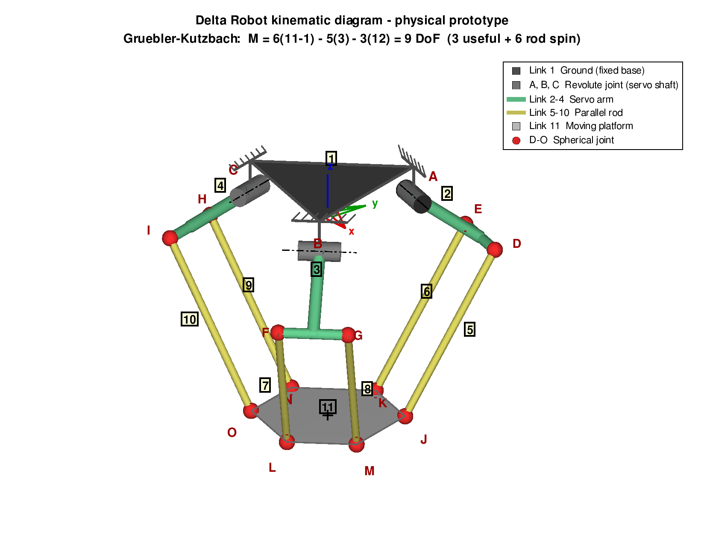
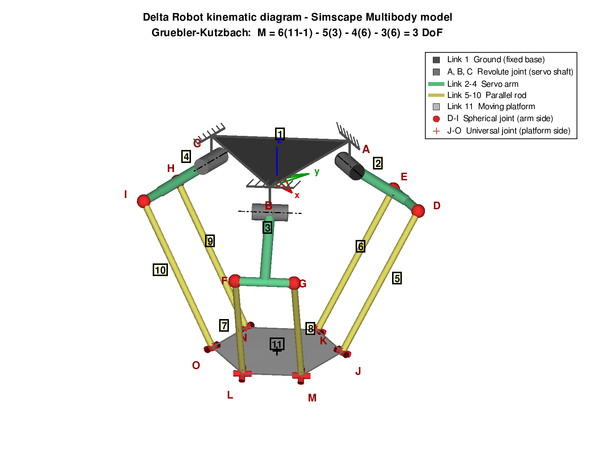
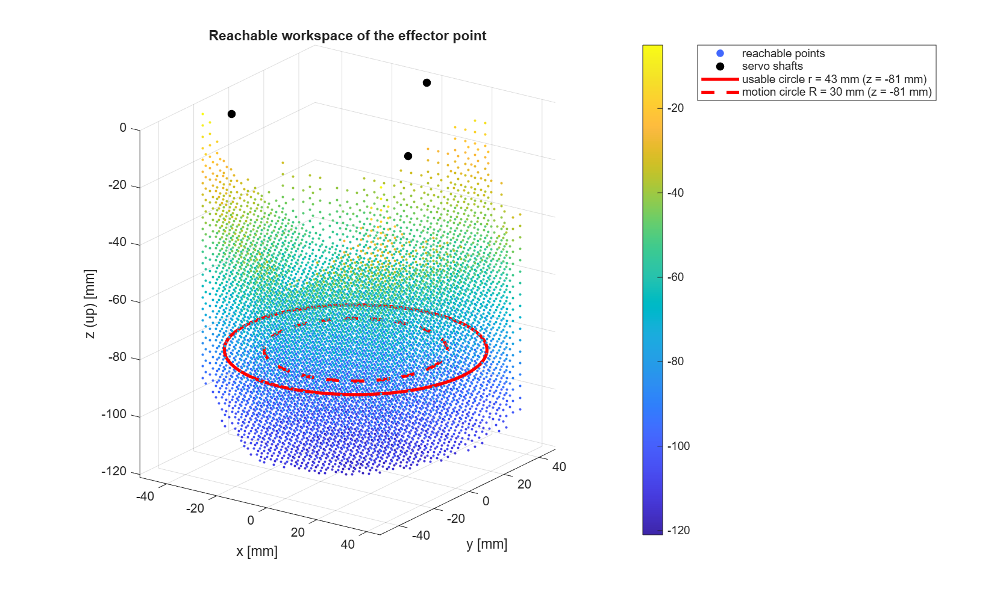
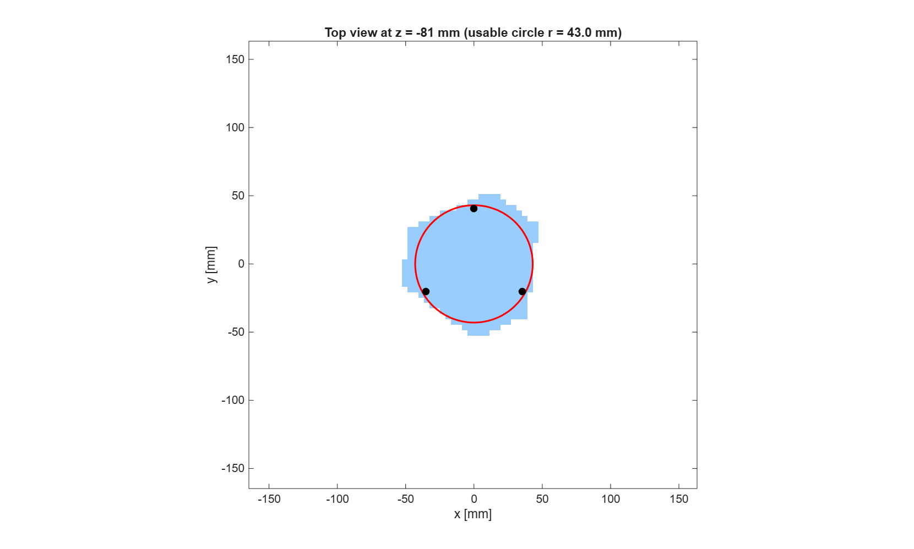
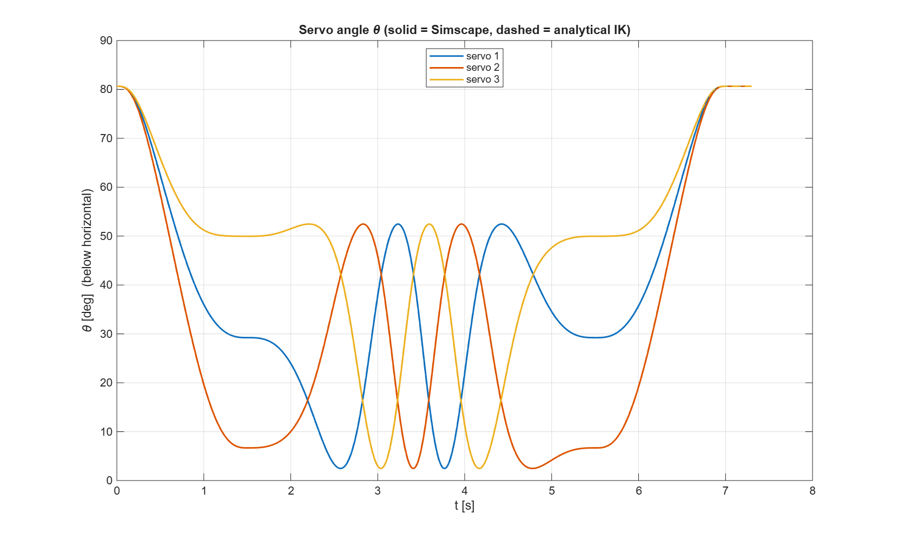
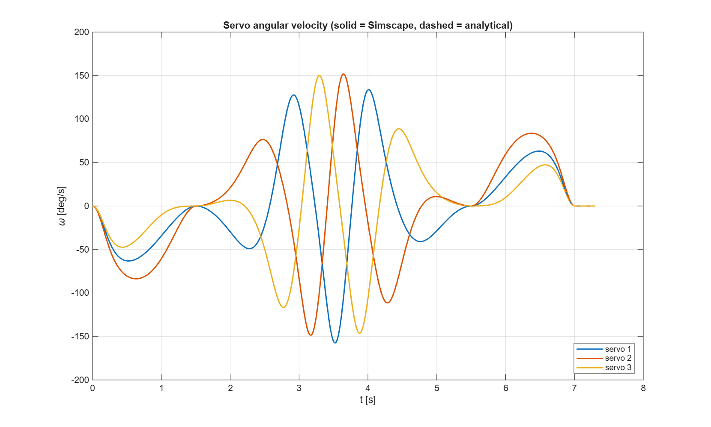
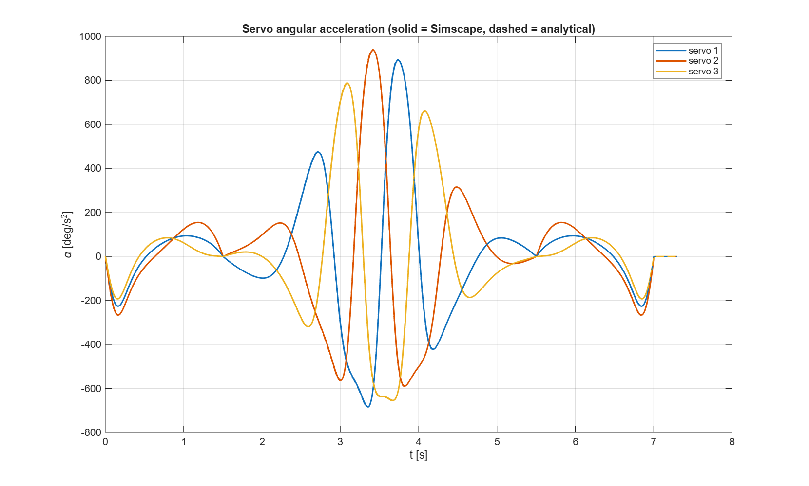
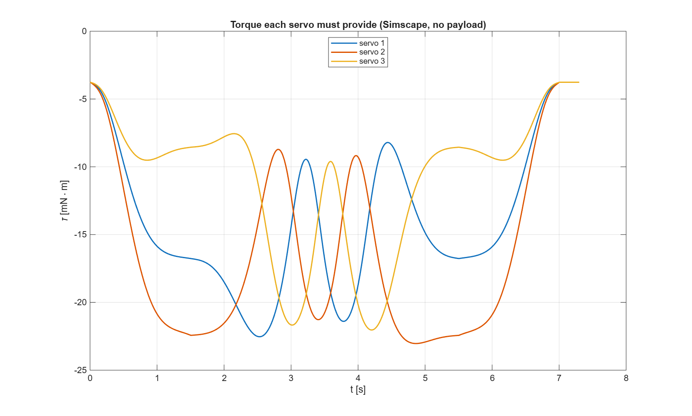

# Design, Kinematic Analysis, and Prototyping of a Delta Robot 
## Project overview
2103322 (2026/1) MECHANICS OF MACHINERY
- **Project name:** Delta Robot
- **Purpose:** To investigate the kinematics of a 3D Delta parallel robot driven by motors on a fixed base, focusing on the link-and-joint relationships that govern the motion of the lower moving platform.
- **Team:** 

  Thanyarat Roongsitmeteekul 6730233721 (Physical prototype)

  Waratchanon Jaroenwong 6730466621 (Multibody simulation)

  Waritsara Jongsomboonpoka 6730472321 (Symbolic mathematics)
- **Status:** Planning
- **Last updated:** 2026-11-20

### Introduction
A Delta Robot is a parallel mechanism widely used in industrial automation, where several links move together to position one platform quickly and accurately. Our Delta Robot has **11 links** connected by revolute and spherical joints. The Grübler–Kutzbach count gives **9 DoF**, which splits into

- **3 external (useful) DoF** – translation of the moving platform along X, Y and Z, and
- **6 internal (passive) DoF** – each of the six parallel rods can spin about its own axis; this does not change the position or orientation of the platform.

Advantages: high speed and accuracy, fewer positioning errors, easy integration with automation systems, and less manual work. Limitations: the design and the kinematic analysis are complex, the workspace is limited, and if the link lengths and joint positions do not match each other the mechanism jams and cannot follow the desired motion.

### Objective
- Study the motion of a Delta Robot, a parallel robot with three motors on a fixed base working in 3-D, focusing on how the links and joints let the lower moving platform move.
- Design and model the robot in SOLIDWORKS and Fusion 360.
- Simulate the motion in MATLAB / Simulink (Simscape Multibody) to check that the mechanism can move as intended.
- Derive the equations of motion of the Delta Robot with MATLAB Symbolic Math.
- Build a 3-D printed prototype, no larger than an A4 sheet, to test the real mechanism and use what we learn in future work.

## Delta Robot

## Mechanism Design, Kinematic Analysis, and Prototyping
This repository contains the complete design and analysis workflow for a Delta Robot, a parallel manipulator with 3 useful DoF (platform translation) driven by three revolute actuators through parallelogram linkages. The project integrates analytical kinematics, symbolic computation, multibody simulation, and hardware design.

## Part I: Kinematic Diagram and DoF analysis
The real Delta robot has 9 degrees of freedom (9 DoF): 3 DoF are the ones we use (translation of the moving platform along X, Y and Z, set by the three servos), and the other 6 DoF belong to the mechanism itself (each parallel rod spinning about its own axis). It employs a parallel-kinematic manipulator mechanism.

### Kinematic diagram
Link 1 is the ground (fixed base). Links are numbered 1–11 and joints are lettered A–O. The colours follow the Simscape Multibody model. The diagram is drawn in 3-D by `delta_schematic.m` (run it in MATLAB; `delta_schematic('prototype')` draws the real robot with 12 spherical joints).

| Link | Name | Count |
|---|---|---|
| 1 | Ground – upper base with the three servo bodies | 1 |
| 2, 3, 4 | Servo arms (upper arms) | 3 |
| 5 – 10 | Parallel rods, two per arm | 6 |
| 11 | Moving platform (end effector) | 1 |
| | **Total N** | **11** |

| Joint | Connects | Physical prototype | Multibody model |
|---|---|---|---|
| A, B, C | Ground 1 – arms 2, 3, 4 (servo shafts) | Revolute (1 DoF) | Revolute (1 DoF) |
| D – I | Arms 2–4 – rods 5–10 | Spherical (3 DoF) | Spherical (3 DoF) |
| J – O | Rods 5–10 – platform 11 | Spherical (3 DoF) | Universal (2 DoF) |

### Degrees of freedom (Grübler–Kutzbach criterion, spatial)

$$M = 6(N-1) - 5J_1 - 4J_2 - 3J_3$$

where $M$ is the mobility (number of DoF), $N$ the number of links including the ground, and $J_1$, $J_2$, $J_3$ the numbers of 1-, 2- and 3-DoF joints.

**Physical prototype** ( $N = 11$, $J_1 = 3$ revolute, $J_3 = 12$ spherical )

$$M = 6(11-1) - 5(3) - 4(0) - 3(12) = 9 \ \text{DoF}$$

- External / useful DoF (3): translation of the moving platform along X, Y and Z.
- Internal / passive DoF (6): spin of each of the six parallelogram rods about its own axis (internal mobility). It does not affect the position or orientation of the end effector, and the parallelogram constraint keeps the platform from tilting.

**Simscape Multibody model** ( $N = 11$, $J_1 = 3$ revolute, $J_2 = 6$ universal, $J_3 = 6$ spherical )

The real robot still has 9 DoF. In the multibody simulation we only study the 3 DoF we use (platform translation), so the platform-side ball joint of every rod is replaced by a universal joint. This removes only the 6 rod-spin DoF of the mechanism: they do not move the platform, and in a simulation nothing stops a free spin, so the solver could not decide where each rod should be. The 3 useful DoF and the platform motion stay exactly the same as in the real robot.

$$M = 6(11-1) - 5(3) - 4(6) - 3(6) = 3 \ \text{DoF}$$

| | Physical prototype | Multibody model |
|---|---|---|
| Total DoF (Grübler–Kutzbach) | 9 | 3 |
| Useful DoF (platform X, Y, Z) | 3 | 3 |
| Mechanism DoF (rod spin) | 6 | 0 (removed by the universal joints) |

[Click to open folder] [docs](docs/)

[Click to open file] [Kinematic diagram script](docs/schematic/delta_schematic.m)

## Part II: Symbolic Math
Analysis of Position, Angle, Velocity, Acceleration, and Force using MATLAB.

Workspace volume (usable, theta in [15,170] deg) = 332.0 cm^3

Total width approx = 229.5 mm 

Velocity check  max|J*thdot - dp/dt| = 3484.253 mm/s

Max torque = 38.4 N.mm (0.39 kg.cm), 3.6 % of stall

Max cond(J) = 1.46 (The closer infinity, the closer to a singularity)

Animation

https://github.com/user-attachments/assets/49e93c41-96c3-493c-aa9b-d0f54fe8aff5

[Click to open folder] [software](software/)

[Click to open file] [Symbolic Math](software/Symbolic%20Math)

## Part III: Simscape Multibody
Delta Robot motion simulation in Simscape Multibody: reachable workspace, a circular trajectory driven by inverse kinematics, and the angle, angular velocity, angular acceleration and torque that each servo joint must deliver.

**Joints:** servo shafts are revolute joints; each rod has a spherical joint at the arm and a universal joint at the platform (see Part I). The model keeps only the 3 useful DoF of the real robot; the 6 rod-spin DoF of the mechanism are removed because they do not move the platform. Each servo revolute joint uses *motion provided by input* and *torque automatically computed*, so Simscape returns the torque the servo must supply.

**Actuator:** `Clock → circle_IK (MATLAB Function) → 3 servo revolute joints`. The block computes the effector position on the path at time *t*, then solves the inverse kinematics (A cos θ + B sin θ = K) to get the three servo angles. The motion parameters are set in one file, `params_delta.m`.

| Geometry (measured from the model) | Value |
|---|---|
| Servo arm length L1 | 40.0 mm |
| Rod length L2 | 82.0 mm |
| Base radius f / Effector radius e | 40.72 mm / 29.64 mm |

### Workspace
Usable full circle r = 43 mm for z = −59 … −105 mm below the servo shafts (best height z = −81 mm), vertical stroke 72 mm.

### Circular motion
Home → straight line → circle R = 30 mm at z = −81 mm (2 laps in 4 s) → home, 7.3 s total, minimum-jerk profile s = 10x³ − 15x⁴ + 6x⁵ (velocity and acceleration start and end at zero).

| Servo joint | Servo 1 | Servo 2 | Servo 3 |
|---|---|---|---|
| Angle θ (below horizontal) | 2.5 - 80.6° | 2.5 - 80.6° | 2.5 - 80.6° |
| Max angular velocity | 157.4 °/s | 151.8 °/s | 150.0 °/s |
| Max angular acceleration | 892 °/s² | 937 °/s² | 787 °/s² |
| Max torque (no payload) | 22.5 mN·m | 23.0 mN·m | 22.0 mN·m |

Effector max speed 176.7 mm/s, max acceleration 1041 mm/s², path deviation ≤ 0.71 mm.
Simscape joint results agree with the analytical velocity/acceleration analysis (θ̇ = sᵀẊ / sᵀC′) within 0.63°, 3.8 °/s and 31 °/s².

Animation

https://github.com/user-attachments/assets/072f497b-4779-4905-a7a6-2cdd2447a263

[Click to open folder] [simulation](simulation/)

[Click to open file] [Multibody README](simulation/README.md)

## Part IV: Prototype
Design and Fabrication of a Delta Robot Prototype Using 3D Printing, with MG996R Servo Motor Installation.

Prototype

Video prototype

https://github.com/user-attachments/assets/066ec897-29dd-44cb-ad2d-f1037f18571c

[Click to open folder] [hardware](hardware/)
