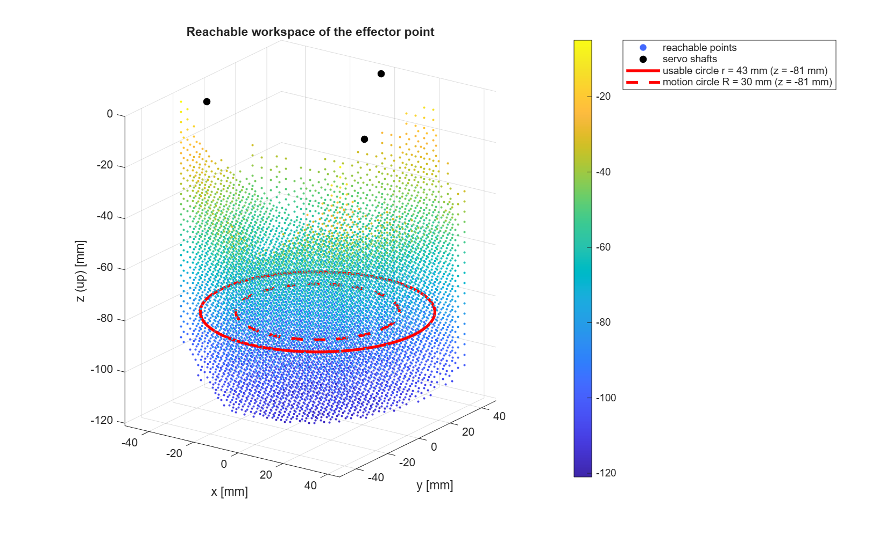
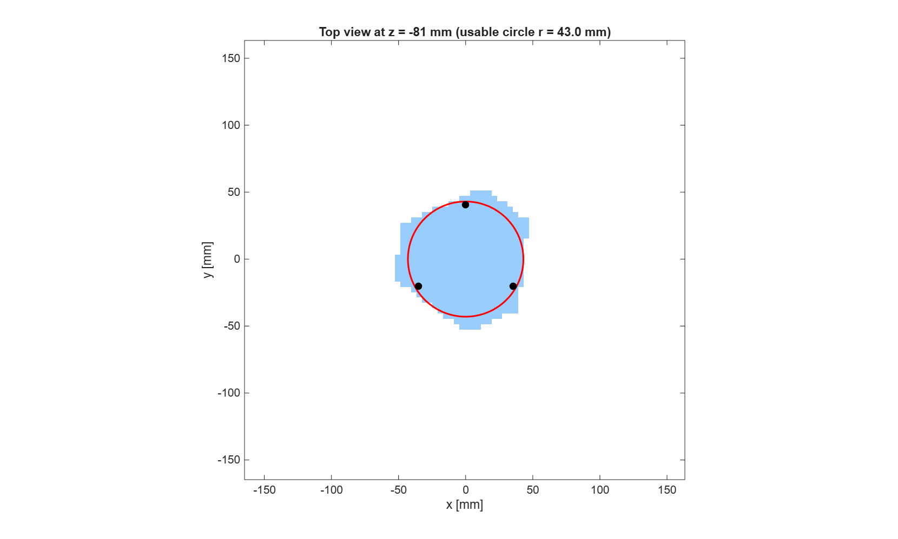
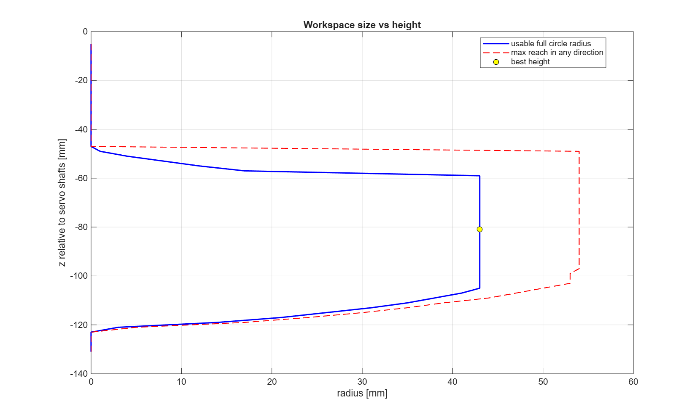
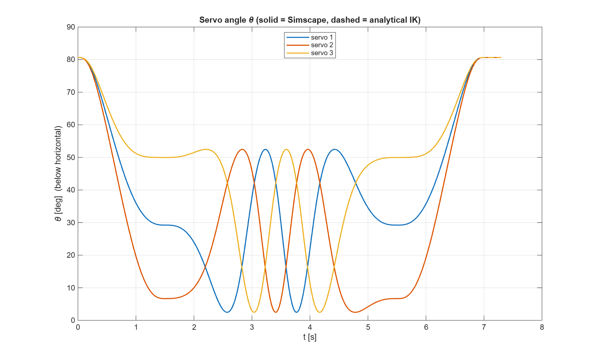
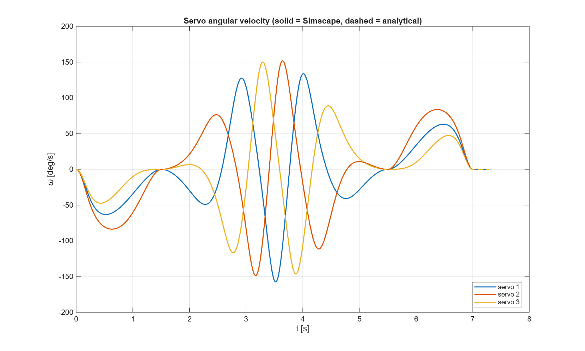
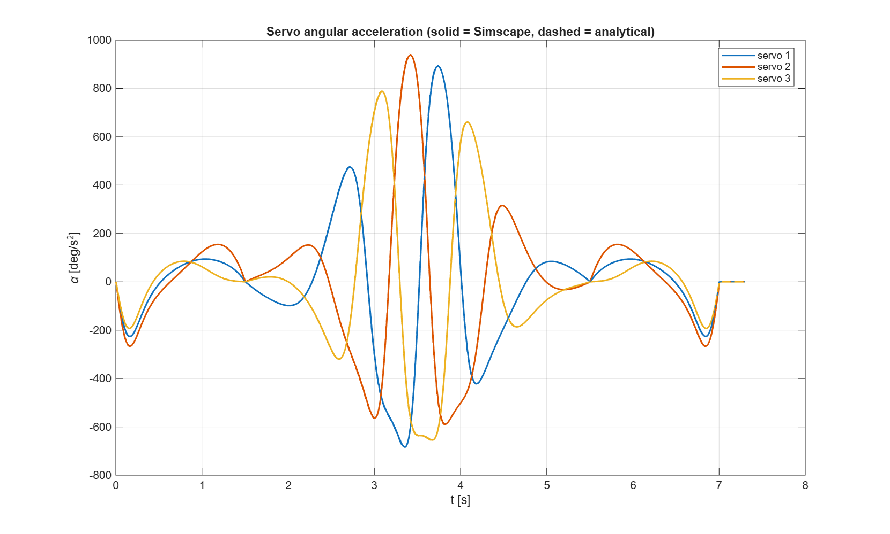
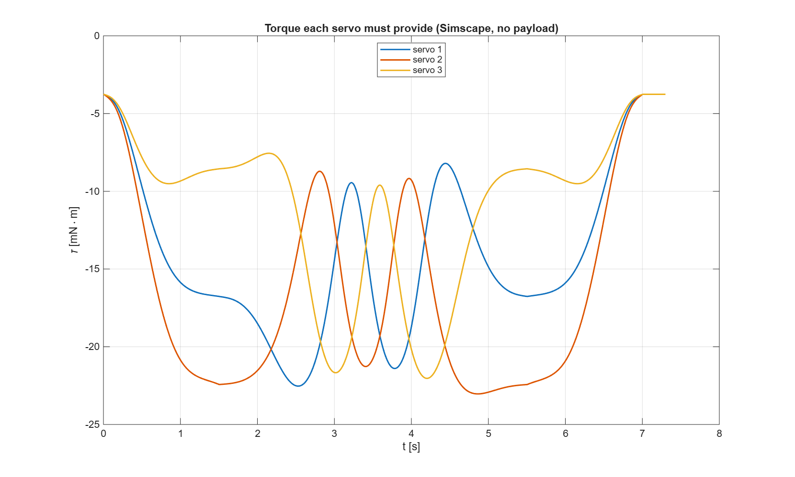

# Simulation — Delta Robot multibody model

Multibody (Simscape Multibody) model of the 3-servo delta robot: reachable workspace, a circular motion driven by inverse kinematics, and the angle, angular velocity, angular acceleration and torque that each servo joint has to deliver.

Video of the motion: [`media/delta_robot_circle_multibody.mp4`](../media/delta_robot_circle_multibody.mp4)

## Software

| Item | Version |
|---|---|
| MATLAB | R2026a Update 4 |
| Toolboxes | Simulink, Simscape, Simscape Multibody |
| CAD import | STEP / SLDPRT through File Solid blocks |

## Folder contents (`simulation/multibody/`)

| Path | Content |
|---|---|
| `open_model.m` | Opens `model/DeltaRobot_V2.slx` (adds the folders to the MATLAB path) |
| `params_delta.m` | **All user parameters** of the motion (circle radius, height, laps, timing) |
| `model/DeltaRobot_V2.slx` | Multibody model with the `circle_IK` actuator (+ referenced subsystems `link_1_V2`, `link2_V2`, `Servo_V2`, CAD files and block icons) |
| `step2_workspace.m` | Reachable workspace |
| `step3_circle.m` | Circle simulation + joint velocity / acceleration / torque analysis |
| `step4_video.m` | Exports the Mechanics Explorer animation (`.mp4`) |
| `lib/` | Kinematics functions (IK, FK, path, analytical velocity/acceleration) |
| `results/geometry.mat` | Robot geometry measured from the model (used by the actuator and the scripts) |
| `results/` | Figures, summaries and time series used in the report |

## Model

| Part | Modelling |
|---|---|
| Upper base + 3 × MG996R servo bodies | Rigid, fixed to the world frame |
| Servo arm (×3) | Revolute joint, **motion provided by input**, **torque automatically computed** |
| Rod (×6, parallelogram pairs) | Spherical joint at the arm ball, universal joint at the effector ball |
| Effector | Rigid plate with 6 balls (translates only) |
| Gravity | 9.80665 m/s² along −Y of the world frame |
| Mass properties | As set in the source model (calculated from the CAD geometry) |

Geometry measured from the model (`results/geometry.mat`, matches the STEP files):

| Quantity | Value |
|---|---|
| Servo arm length L1 (shaft → ball-pair midpoint) | 40.0 mm |
| Rod length L2 (socket centre to socket centre) | 82.0 mm |
| Base radius f (robot axis → servo shaft) | 40.72 mm |
| Effector radius e (centre → ball-pair midpoint) | 29.64 mm |
| Ball spacing of a parallelogram | 30.0 mm |
| Home pose (all servos at the original Constant value) | effector 119.5 mm below the servo shafts |

Robot frame used in all results: origin on the robot axis at the height of the servo shafts, z up, y toward servo 1 (servos at 90°, −30°, −150°).

### Actuator

```
Clock ──► circle_IK (MATLAB Function) ──► Demux ──► Simulink-PS Converter ──► servo Revolute Joints
```

`circle_IK` (code in `lib/circle_IK_block_code.m`) computes, at every time step:

1. **Effector position on the path** — home → straight line to the circle → `laps` turns → straight line back home. Each phase uses the minimum-jerk blend
   s(x) = 10x³ − 15x⁴ + 6x⁵, so velocity and acceleration start and end at zero. On the circle: x = R cos φ, y = R sin φ, z = z_c, φ = 2π·laps·s.
2. **Inverse kinematics** for each arm i, from the constant rod length |s_i| = L2 with s_i = X + E_i − C_i(θ_i):
   A cos θ + B sin θ = K  →  θ = atan2(B, A) ± acos(K / √(A² + B²)) (elbow-out branch).

### Velocity and acceleration analysis (analytical check)

Differentiating the rod-length constraint once and twice gives, for each servo (`lib/circle_kinematics.m`):

- θ̇_i = s_iᵀẊ / (s_iᵀC_i′)
- θ̈_i = [s_iᵀ(Ẍ − C_i″ θ̇_i²) + |ṡ_i|²] / (s_iᵀC_i′),  with C_i′ = dC_i/dθ, C_i″ = d²C_i/dθ², ṡ_i = Ẋ − C_i′θ̇_i

The Simscape results (joint sensors) are plotted together with these formulas.

### Solver settings

| Setting | Value |
|---|---|
| Solver | Variable-step, automatic selection (model default) |
| Stop time | `circ.Tend` = 7.3 s |
| Angle input filter (Simulink-PS Converter) | 2nd order, time constant 2 ms |
| Logged signals | joint angle, angular velocity, angular acceleration, actuator torque; effector position; sample time 2 ms |

## Assumptions and limits of validity

- Rigid bodies; no joint friction, backlash, or compliance of the 3D-printed parts.
- The servo follows the commanded angle (prescribed motion); motor dynamics and speed/torque limits are not modelled — the results give the **required** servo speed, acceleration and torque.
- No payload on the effector.
- Workspace limits: arm angle −30° … 90° below horizontal, ball-joint tilt ≤ 35° (assumed socket limit); collisions between parts are not checked.

## How to reproduce

```matlab
cd simulation/multibody
open_model            % open the model; press Run to see the motion in Mechanics Explorer
step2_workspace       % results/workspace/
step3_circle          % results/circle/
step4_video           % set the view in Mechanics Explorer first (Y up, Iso)
```

To change the motion, edit `params_delta.m` and run `step3_circle` again (or press Run in the model).

## Results

### Workspace

| Item | Value |
|---|---|
| Vertical reach on the robot axis | z = −49 … −121 mm (stroke 72 mm) |
| Largest usable full circle | r = 43 mm for z = −59 … −105 mm |
| Best work height | z = −81 mm |
| Max horizontal reach | 54 mm from the axis |



|  |  |
|---|---|

### Circle motion (R = 30 mm at z = −81 mm, 2 laps in 4 s, 7.3 s total)

| Servo joint | servo 1 | servo 2 | servo 3 |
|---|---|---|---|
| Angle θ (below horizontal) | 2.5 … 80.6° | 2.5 … 80.6° | 2.5 … 80.6° |
| Max angular velocity | 157.4 °/s (2.75 rad/s) | 151.8 °/s (2.65 rad/s) | 150.0 °/s (2.62 rad/s) |
| Max angular acceleration | 892 °/s² (15.6 rad/s²) | 937 °/s² (16.4 rad/s²) | 787 °/s² (13.7 rad/s²) |
| Max torque | 22.5 mN·m (0.230 kgf·cm) | 23.0 mN·m (0.235 kgf·cm) | 22.0 mN·m (0.225 kgf·cm) |
| RMS torque | 14.9 mN·m | 17.5 mN·m | 12.0 mN·m |

| Other | Value |
|---|---|
| Effector max speed / acceleration | 176.7 mm/s / 1041 mm/s² |
| Effector path deviation (Simscape vs command) | ≤ 0.71 mm |
| Passive ball joints, max relative angular velocity | arm side 124 °/s, effector side 129 °/s |
| Simscape vs analytical, max difference | θ 0.63°, ω 3.8 °/s, α 31 °/s² (2 ms input-filter lag) |

|  |  |
|---|---|
|  |  |

Full numbers: `multibody/results/circle/summary.txt`; time series: `multibody/results/circle/servo_timeseries.csv`.
